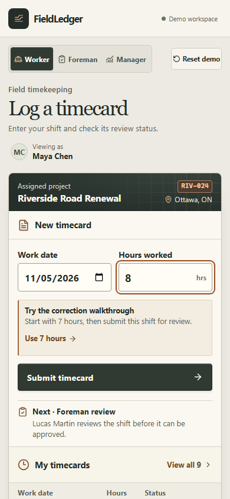
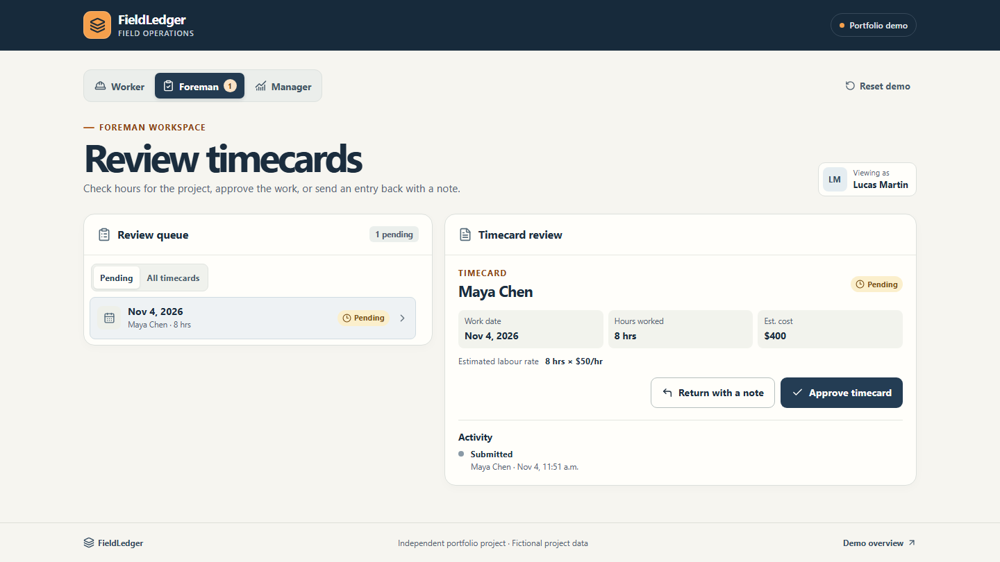
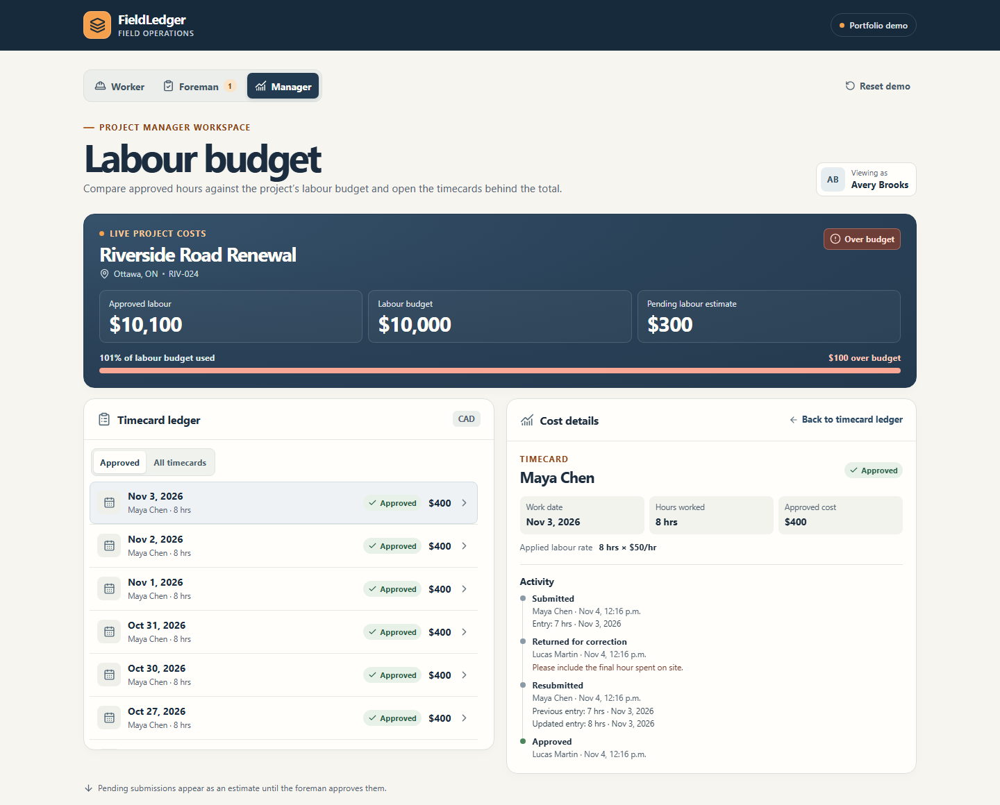

# FieldLedger

FieldLedger is a working construction timecard and labour-costing demo. It follows one timecard from a worker's phone through foreman review to the project manager's budget.

[Open the live demo](https://fieldledger.swoop.video/) · [Full workflow walkthrough](https://github.com/yazanbaker94/fieldledger/releases/tag/v1.0.7)

## 15-second website walkthrough

Maya corrects and resubmits her timecard. When the foreman approves it, CAD $400 posts to the ledger and approved labour crosses the CAD $10,000 budget.

https://github.com/user-attachments/assets/47c1b8f1-1224-4546-8629-7f1635041f72

## Try the workflow

1. As **Worker**, choose **Use 7 hours** in the correction walkthrough, then submit the timecard. Select **Go to foreman** to open that card.
2. As **Foreman**, choose **Return with a note**, then **Use example note** and send it back. **Go to worker** opens the same card. Choose **Use 8 hours**, resubmit, and return to Foreman to approve it.
3. After approval, **Go to manager** traces the saved posting. Each layer in the Cost Trail represents an hour of work. The eight hours add CAD $400 to the CAD $9,700 already approved, taking the project CAD $100 over its CAD $10,000 labour budget. Select a ledger row to inspect its source timecard and cost.

Each browser gets its own demo workspace backed by PostgreSQL. Refreshing the page preserves its data during the 24-hour session. If a tab is still running an older build when its session ends, reload the page to open a new workspace. The role switcher is intentionally available to demo visitors. **Reset demo** restores the starting budget and fictional crew history.

## Screens from the running app

| Worker on a phone | Foreman reviewing the card | Manager after approval |
| --- | --- | --- |
| [](docs/screenshots/worker.png) | [](docs/screenshots/foreman.png) | [](docs/screenshots/manager.png) |

[See the mobile correction prompt](docs/screenshots/worker-correction.png).

## Run locally

Use Node.js 22.12 or newer and a dedicated PostgreSQL database. Copy `.env.example` to `.env` and set the connection string for that database.

```sh
npm ci
npm run build
npm start
```

Open [FieldLedger locally](http://localhost:3000). The server applies the schema and loads the fictional source data on startup.

For UI development, run `npm run dev:api` and `npm run dev` in separate terminals. Vite proxies API requests to port 3000 by default.

## How it works

- React and TypeScript render the phone and desktop views. A TypeScript API checks input and enforces valid timecard transitions.
- PostgreSQL stores source records, workspace state, timecards, and review events. Approval stores the applied labour rate and the exact cost, so changing a reference rate leaves earlier approvals historically accurate.
- The server enforces a 24-hour daily limit per worker across split entries. If a submission is interrupted, tabs in the same browser workspace can check, retry, or discard the same request safely.
- Foreman and manager selections stay in the URL across reloads. A changed revision requires an explicit review before approval. A Worker handoff link continues to show the same card after correction.
- Audit history records the hours and work date on new submissions and preserves both values when a card is corrected.
- CSV fixtures supply initial reference values. Once imported, PostgreSQL rates determine the cost of both newly seeded history and new timecards using each work date.
- The budget view sums approved timecards in SQL. Pending labour is displayed separately. The approval, cost, and audit event commit in one transaction. Open Manager views in the same workspace refresh after changes and identify cached figures if the live connection drops.
- The prototype uses one assigned project and regular-time labour in Canadian dollars. Its budget comparison uses approved labour cost.

### Foundry mapping

FieldLedger is a standalone implementation inspired by the [Foundry Ontology](https://www.palantir.com/docs/foundry/ontology/overview). This design would map to Foundry as follows.

| FieldLedger | Foundry equivalent |
| --- | --- |
| Validated fictional CSV inputs | Source datasets and a pipeline transform |
| Workers, projects, and timecards | Object types connected by links |
| Submit, return, resubmit, and approve commands | Governed Ontology Actions |
| Role-specific forms, queue, and budget view | Workshop views or a custom OSDK app |

## Verify

Point `DATABASE_URL` to a disposable PostgreSQL database for integration and browser tests.

```sh
npm run build
npm test
npx playwright install chromium
npm run test:browser
npm run screenshots
```

The full browser suite creates more fresh workspaces than the public per-IP limit allows. Run the full suite against a local test database. For a deployed HTTPS smoke check, use the single workflow that opens two demo workspaces.

```sh
FIELDLEDGER_TEST_URL=https://fieldledger.swoop.video npm run test:browser -- --grep 'screenshots and persistent budget changes'
```

The screenshot command captures the worker, foreman, and manager views from a running app.

The [VPS deployment guide](deploy/README.md) covers the PostgreSQL volume, origin health checks, and Cloudflare routing.

### Welcome photo

The fictional [Riverside Road Renewal photo](public/images/riverside-roadwork.webp) was created with the built-in ImageGen tool. The screenshots above were captured from the running app.

<details>
<summary>ImageGen prompt</summary>

Use case: photorealistic-natural. Create the original banner photograph for a polished Ontario civil construction timecard web application. Wide landscape photograph composed for a crop about 16:9. A real-looking small road reconstruction project outside Ottawa in early autumn. One distant worker viewed from behind in a safety-orange high-visibility vest and hard hat and a yellow roadwork excavator farther along the half-graded road, with utility cones and gravel shoulder. Canadian mixed forest in the background. Keep the main action in the central/right two thirds, with naturally quiet gravel and sky on the left. Quiet early morning warm light, subtle slate-blue shadows, earthy beige and restrained orange, natural documentary editorial photography, crisp grounded detail, no glamor or dramatic effects. Worksite looks organized and equipment is safely distant from people. No text, logos, recognizable brands, watermarks, UI, graphics, or frame.

</details>
